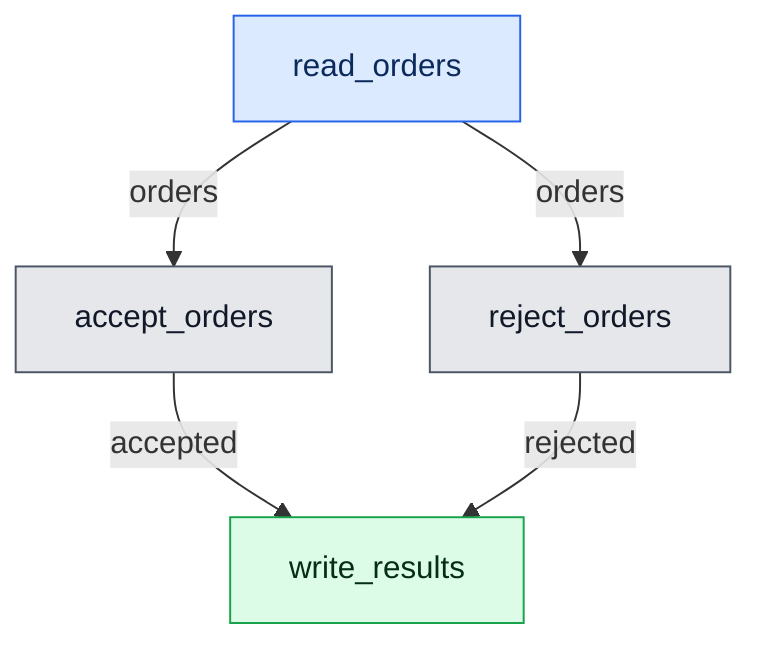

# Example: a pipeline with swappable storage

A small, complete pipeline you can copy, run and test. It reads orders, splits
them into accepted and rejected, and writes both. The storage sits behind a
`Protocol`, so production uses files and tests use an in-memory fake.

It puts together what the rest of the guide covers:

- a Pydantic [context](../guide/context.md) holding only validated config,
- a store injected through a factory function (Pattern B),
- [fan-out and fan-in](../guide/fan-out.md),
- a [completion marker](../guide/errors.md#write-the-completion-marker-last),
- [tests](../guide/testing.md) with a fake store, mocked writes, and real
  writes to `tmp_path`,
- the [`to_mermaid()`][masoora.Pipeline.to_mermaid] diagram.

It needs only masoora and pytest.

## The pipeline

Save as `orders_pipeline.py`:

```python
from __future__ import annotations

import json
from pathlib import Path
from typing import Any, Protocol

from pydantic import Field

from masoora import Pipeline, PipelineBuilder, PipelineContext

Rows = list[dict[str, Any]]


class Store(Protocol):
    """The pipeline's only view of storage."""

    def read(self, name: str) -> Rows: ...

    def write(self, name: str, rows: Rows) -> None: ...


class LocalStore:
    """JSON-lines files in a directory. Writes are atomic: temp file, then rename."""

    def __init__(self, root: Path) -> None:
        self.root = root

    def read(self, name: str) -> Rows:
        text = (self.root / f"{name}.jsonl").read_text()
        return [json.loads(line) for line in text.splitlines()]

    def write(self, name: str, rows: Rows) -> None:
        self.root.mkdir(parents=True, exist_ok=True)
        tmp = self.root / f"{name}.jsonl.tmp"
        tmp.write_text("".join(json.dumps(row) + "\n" for row in rows))
        tmp.replace(self.root / f"{name}.jsonl")


class FakeStore:
    """In-memory store for tests. Records writes in order."""

    def __init__(self, tables: dict[str, Rows] | None = None) -> None:
        self.tables = dict(tables or {})
        self.writes: list[str] = []

    def read(self, name: str) -> Rows:
        return self.tables[name]

    def write(self, name: str, rows: Rows) -> None:
        self.tables[name] = rows
        self.writes.append(name)


class OrdersContext(PipelineContext):
    """Validated configuration only. Clients and stores do not live here."""

    run_date: str = Field(pattern=r"^\d{4}-\d{2}-\d{2}$")
    min_amount: float = Field(default=1.0, ge=0)


def build_pipeline(store: Store) -> Pipeline[OrdersContext]:
    def read_orders(ctx: OrdersContext) -> Rows:
        return store.read("orders")

    def accept_orders(ctx: OrdersContext, orders: Rows) -> Rows:
        return [o for o in orders if o["amount"] >= ctx.min_amount]

    def reject_orders(ctx: OrdersContext, orders: Rows) -> Rows:
        return [o for o in orders if o["amount"] < ctx.min_amount]

    def write_results(ctx: OrdersContext, accepted: Rows, rejected: Rows) -> None:
        store.write(f"accepted_{ctx.run_date}", accepted)
        store.write(f"rejected_{ctx.run_date}", rejected)
        store.write(f"_done_{ctx.run_date}", [])  # completion marker, written last

    return (
        PipelineBuilder[OrdersContext]()
        .with_read_step(read_orders, output="orders")
        .with_transform_step(accept_orders, inputs=["orders"], output="accepted")
        .with_transform_step(reject_orders, inputs=["orders"], output="rejected")
        .with_write_step(write_results, inputs=["accepted", "rejected"])
        .build()
    )
```

What to notice:

- `Store` is a structural `Protocol`. Neither `LocalStore` nor `FakeStore`
  inherits from it; they just have the right methods, and a type checker
  confirms it.
- `OrdersContext` is plain, validated data. `run_date="yesterday"` fails when
  the context is constructed, before anything is read.
- The four step functions are closures inside `build_pipeline`, so they use
  `store` without it being in the context. They are defined with `def`, so
  errors and diagrams show `read_orders`, not `<lambda>`.
- `write_results` writes the marker last, and `LocalStore.write` renames a
  finished temp file into place, so a re-run replaces earlier output and a
  failed run leaves no marker.

## Running it

```python
from pathlib import Path

from orders_pipeline import LocalStore, OrdersContext, build_pipeline

store = LocalStore(Path("data"))
store.write("orders", [{"id": 1, "amount": 5.0}, {"id": 2, "amount": 0.5}])

catalog = build_pipeline(store).run(OrdersContext(run_date="2026-01-31"))
print(f"accepted={len(catalog['accepted'])} rejected={len(catalog['rejected'])}")
```

```text
accepted=1 rejected=1
```

`data/` now holds `accepted_2026-01-31.jsonl`, `rejected_2026-01-31.jsonl` and
the empty marker `_done_2026-01-31.jsonl`.

## The diagram

```python
from orders_pipeline import FakeStore, build_pipeline

print(build_pipeline(FakeStore()).to_mermaid())
```



## The tests

Save as `test_orders_pipeline.py` and run `pytest`:

```python
from pathlib import Path

from orders_pipeline import FakeStore, LocalStore, OrdersContext, build_pipeline

ORDERS = [
    {"id": 1, "amount": 5.0},
    {"id": 2, "amount": 0.5},
    {"id": 3, "amount": 12.0},
]


def test_split_with_fake_store() -> None:
    store = FakeStore({"orders": ORDERS})
    catalog = build_pipeline(store).run(OrdersContext(run_date="2026-01-31"))

    assert [o["id"] for o in catalog["accepted"]] == [1, 3]
    assert [o["id"] for o in catalog["rejected"]] == [2]
    assert store.writes[-1] == "_done_2026-01-31"  # marker is last


def test_mocked_writes_capture_both_inputs() -> None:
    pipeline = build_pipeline(FakeStore())
    ctx = OrdersContext(run_date="2026-01-31")
    result = pipeline.to_testable(reads={"orders": ORDERS}).run(ctx)

    assert set(result.written) == {"accepted", "rejected"}


def test_local_store_round_trip(tmp_path: Path) -> None:
    store = LocalStore(tmp_path)
    store.write("orders", ORDERS)
    build_pipeline(store).run(OrdersContext(run_date="2026-01-31", min_amount=10))

    assert [o["id"] for o in store.read("accepted_2026-01-31")] == [3]
    assert (tmp_path / "_done_2026-01-31.jsonl").exists()
```

The three tests exercise the pipeline at three levels:

1. **Fake store.** The whole pipeline runs, including the write step, with no
   disk. Because the fake records the order of writes, the test can also check
   that the marker came last.
2. **`to_testable()`.** Reads are replaced by `reads=` and the write step is
   captured instead of run, so `written` shows what would have been stored
   under each of the write step's input keys. This needs no store at all —
   `FakeStore()` is only there to satisfy the factory.
3. **Real local store.** `LocalStore` runs against pytest's `tmp_path`,
   covering the file layout and the atomic rename.

## Swapping in a real backend

Write a class with the same two methods for your warehouse or bucket, and pass
it to `build_pipeline`. Nothing else changes: the context, the steps, the
diagram and the tests stay as they are.
