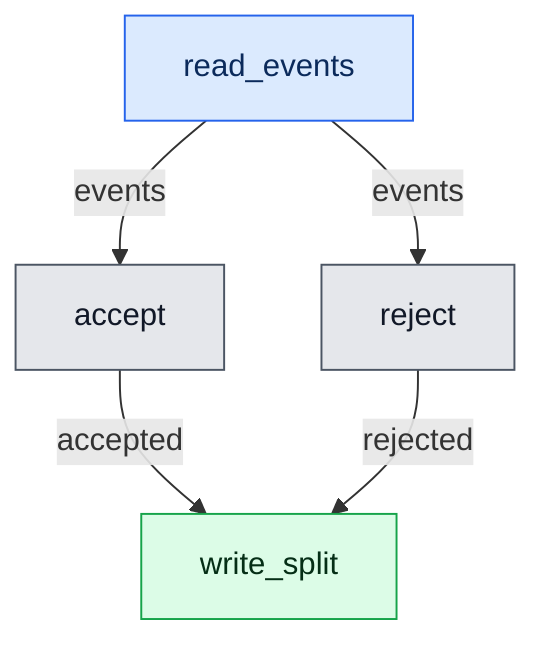

# Fan-out and fan-in

A step has **exactly one output**: a read or transform step stores one value at
one catalog key, and a write step stores nothing. There is no way for a single
step to return two datasets.

Splitting data is still easy. You do it with several steps that read the same
key — *fan-out* — and join the results back with a step that takes several
inputs — *fan-in*.

## Splitting one dataset into two

Say each event gets a score, and you want the good ones and the rest kept
separately. Two transform steps read the same `events` key and each produce
their own output:

```python
from typing import Any

from masoora import PipelineBuilder, PipelineContext

Rows = list[dict[str, Any]]


class Config(PipelineContext):
    min_score: float = 0.5


def read_events(ctx: Config) -> Rows:
    return [{"id": 1, "score": 0.9}, {"id": 2, "score": 0.1}, {"id": 3, "score": 0.7}]


def accept(ctx: Config, events: Rows) -> Rows:
    return [e for e in events if e["score"] >= ctx.min_score]


def reject(ctx: Config, events: Rows) -> Rows:
    return [e for e in events if e["score"] < ctx.min_score]


def write_split(ctx: Config, accepted: Rows, rejected: Rows) -> None:
    print(f"writing {len(accepted)} accepted and {len(rejected)} rejected")


pipeline = (
    PipelineBuilder[Config]()
    .with_read_step(read_events, output="events")
    .with_transform_step(accept, inputs=["events"], output="accepted")
    .with_transform_step(reject, inputs=["events"], output="rejected")
    .with_write_step(write_split, inputs=["accepted", "rejected"])
    .build()
)

catalog = pipeline.run(Config())
```

Running it prints:

```text
writing 2 accepted and 1 rejected
```

`accept` and `reject` both receive the *same* `events` object. Neither is
allowed to modify it — see [the catalog is shared](#the-catalog-is-shared) below.

The predicate is written twice, once per side. If that bothers you, factor the
condition into a helper that both steps call; keeping the two steps separate is
what lets the diagram show the split.

## The diagram

`print(pipeline.to_mermaid())` for the pipeline above produces:



The fan-out is the two arrows leaving `read_events`; the fan-in is the two
arrows entering `write_split`.

## How a write step receives several inputs

A write step — and a transform step — is called as `fn(ctx, *inputs)`: the
context first, then one **positional argument per input key, in the order you
list them in `inputs=`**.

```python
.with_write_step(write_split, inputs=["accepted", "rejected"])
#                                      ^ 1st        ^ 2nd
def write_split(ctx, accepted, rejected): ...
```

Swapping the list to `["rejected", "accepted"]` swaps the arguments. Argument
names do not matter to masoora, only position, so name them for the keys and
keep the two lists in the same order.

The order is a property of the step's declaration, not of when the inputs were
produced. Which of `accept` and `reject` ran first has no effect on it.

## Several inputs, no split

Fan-in does not need a fan-out before it. Any step can take inputs from any
number of independent branches:

```python
.with_read_step(read_orders, output="orders")
.with_read_step(read_customers, output="customers")
.with_transform_step(join, inputs=["orders", "customers"], output="enriched")
```

In [parallel mode](parallel.md) the two reads run concurrently, and `join`
starts as soon as both have finished.

## The catalog is shared

Both branches read the same object out of the catalog; masoora does not copy
it. Polars and pandas transformations that return new frames are safe. A step
that mutates its input in place — sorting a list, or `df.drop(inplace=True)` —
changes what its sibling sees, and under `parallel=True` that becomes a race.
Return new values.

## Where the outputs end up

After `run()`, both `catalog["accepted"]` and `catalog["rejected"]` are still
there — a write step does not consume its inputs. See
[Getting results out](pipelines.md#getting-results-out).

In tests, [`TestRunResult.written`][masoora.TestRunResult] captures a mocked
write step under *each* of its input keys:

```python
result = pipeline.to_testable().run(Config())
assert result.written.keys() == {"accepted", "rejected"}
```
