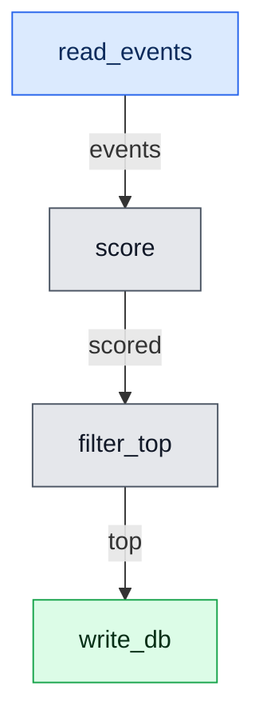

# Building pipelines

A pipeline is a set of steps plus the dependencies between them. You declare
steps on a [`PipelineBuilder`][masoora.PipelineBuilder], call
[`build()`][masoora.PipelineBuilder.build], and get a validated
[`Pipeline`][masoora.Pipeline].

```python
from masoora import PipelineBuilder, PipelineContext


class MyContext(PipelineContext):
    source_url: str
    min_score: float = 0.5


pipeline = (
    PipelineBuilder[MyContext]()
    .with_read_step(read_events, output="events")
    .with_transform_step(score, inputs=["events"], output="scored")
    .with_transform_step(filter_top, inputs=["scored"], output="top")
    .with_write_step(write_db, inputs=["top"])
    .build()
)
```

## The context

Every step receives the same context object as its first argument. It is a
Pydantic model, so it is validated once at construction and is typed
everywhere downstream.

```python
class MyContext(PipelineContext):
    source_url: str
    min_score: float = 0.5
```

Treat the context as **read-only**. Steps that mutate it break the parallel
execution contract — see [Parallel execution](parallel.md). For what belongs in
the context and what to inject some other way, see
[Context and dependency injection](context.md).

## The three step kinds

| Step kind | Signature | Effect |
|---|---|---|
| read | `fn(ctx) -> dataset` | `catalog[output] = result` |
| transform | `fn(ctx, *inputs) -> dataset` | `catalog[output] = result` |
| write | `fn(ctx, *inputs) -> None` | terminal |

A step has exactly one output, and a write step has none. To split a dataset
or join several, see [Fan-out and fan-in](fan-out.md).

The distinction is not cosmetic. Reads and writes are the pipeline's edges —
the places it touches the outside world — and those are exactly what the
testing helpers replace. Transforms are pure functions of their inputs and run
unchanged in tests.

## The catalog

Steps communicate through a [`DataCatalog`][masoora.DataCatalog]: an in-memory
key → dataset store. A step's `output` names the key it writes; a step's
`inputs` name the keys it reads.

masoora never inspects the values, so a dataset can be a polars DataFrame, a
pandas DataFrame, a Spark DataFrame, a list of dicts, or anything else.

```python
catalog = pipeline.run(MyContext(source_url="https://..."))
top = catalog["top"]
```

### Seeding the catalog

Keys that are populated before the run — passed in from a caller rather than
produced by a read step — are declared with `.with_seed(key)`:

```python
pipeline = (
    PipelineBuilder[MyContext]()
    .with_seed("events")
    .with_transform_step(score, inputs=["events"], output="scored")
    .build()
)
```

Without the declaration, `build()` rejects the pipeline: `events` would be an
input no step produces.

## Declaration order does not matter

`build()` topologically sorts the steps, so you can declare them in whatever
order reads best:

```python
pipeline = (
    PipelineBuilder[MyContext]()
    .with_write_step(write_db, inputs=["top"])  # declared first
    .with_read_step(read_events, output="events")  # runs first
    .with_transform_step(score, inputs=["events"], output="scored")
    .with_transform_step(filter_top, inputs=["scored"], output="top")
    .build()
)
```

## Seeing the pipeline

[`to_mermaid()`][masoora.Pipeline.to_mermaid] renders the pipeline as a Mermaid
flowchart:

```python
print(pipeline.to_mermaid())
```



Steps are nodes, coloured by kind. Catalog keys label the edges, except at the
boundaries: seeded inputs and outputs nothing consumes get their own nodes, so
you can see what the pipeline takes and what it leaves behind.


No dependencies are involved — the output is text. Paste it into a
```` ```mermaid ```` fence and GitHub, these docs, and Jupyter all render it.

Two arguments:

```python
pipeline.to_mermaid(direction="LR")       # TD, TB, BT, LR, RL
pipeline.to_mermaid(target="scored")      # only the steps feeding one key
```

Output is deterministic for a given pipeline, so a committed diagram only
changes when the pipeline does.

## Validation happens at build time

`build()` is where a malformed pipeline fails, not partway through a run:

- an input no step produces and no seed declares →
  [`PipelineValidationError`][masoora.PipelineValidationError]
- a dependency cycle → [`PipelineCycleError`][masoora.PipelineCycleError]

This matters because the alternative — discovering a missing key after the
read step has already pulled a million rows — is expensive.

At run time, a step that raises is wrapped in
[`StepExecutionError`][masoora.StepExecutionError] so you get the failing
step's identity alongside the original traceback. See
[Errors and retries](errors.md).

Structure is checked at build time; the data itself is checked at run time, and
only for keys you have given a schema. See [Data validation](validation.md).

## Running part of a pipeline

Pass `target` to run only the steps needed to produce one key:

```python
catalog = pipeline.run(ctx, target="top")
```

Steps that `top` does not depend on are skipped entirely — including the write
step, which is often what you want while iterating.

## Step names

Errors and diagrams identify a step by its `name`. The name is the step
function's `__name__`:

| You pass | `name` is |
|---|---|
| a function defined with `def` | the function name, e.g. `"score"` |
| a bound method | the method name, e.g. `"meth"` |
| a `lambda` | `"<lambda>"` — the same for every lambda |
| a `functools.partial` | its `repr`, e.g. `functools.partial(<function scale at 0x…>, factor=3)` |
| a callable object without `__name__` | its `repr` |

Anything that has no `__name__` falls back to `repr(fn)`, which includes a memory
address and changes from run to run.

**Use named functions.** A `StepExecutionError` for `"<lambda>"` does not say
which lambda failed, and the diagram has several indistinguishable nodes. When
you need a `partial`, give the result a name:

```python
import functools


def scale(ctx, rows, *, factor):
    return [r * factor for r in rows]


scale_by_3 = functools.partial(scale, factor=3)
scale_by_3.__name__ = "scale_by_3"  # now it reads well in errors and diagrams
```

Alternatively define a small closure with `def` — see
[Context and dependency injection](context.md).

Names do not have to be unique. Output keys do: two steps writing the same key
is a `PipelineValidationError` at `build()`.

## Step order

`pipeline.steps` is the order steps run in sequential mode, and it is
**deterministic**: `build()` sorts steps so each runs after the steps it depends
on, and when several steps are ready at once, the one **declared first** goes
first. The same builder code always yields the same order.

```python
PipelineBuilder[Config]()
.with_read_step(read_b, output="b")      # declared 1st
.with_read_step(read_a, output="a")      # declared 2nd
.with_transform_step(use_b, inputs=["b"], output="b2")
.with_transform_step(use_a, inputs=["a"], output="a2")
# runs: read_b, read_a, use_b, use_a
```

Rules to take from this:

- **Order between independent steps is a convenience, not a contract.** It is
  stable today, but a step that needs another to run first should say so by
  consuming its output.
- **In [parallel mode](parallel.md)** independent steps run concurrently and
  finish in no particular order.
- Anything that must be ordered but has no data to pass — two writes, say —
  belongs in one step. See [Errors and retries](errors.md).

## Getting results out

Write steps return `None`, and `run()` returns the catalog. To report counts or
results after a run, read them from that catalog; a write step does not consume
its inputs, so they are all still there:

```python
catalog = pipeline.run(ctx)

print(f"accepted={len(catalog['accepted'])} rejected={len(catalog['rejected'])}")
```

The catalog is an ordinary mapping, so `list(catalog)` lists the keys and
`catalog.snapshot()` returns a plain `dict` copy. Reading with `catalog[key]`
runs the key's validator if it has not been checked yet; `snapshot()` skips
validation.

If the number you want is not a dataset — rows written, say — make it one:
have a transform step output a small summary, or compute it from the catalog
after the run. Do not smuggle results out through the context; it is read-only
([Context and dependency injection](context.md#treat-the-context-as-read-only)).

`run()` raises instead of returning when a step fails, so a returned catalog
means every step succeeded. See [Errors and retries](errors.md).

## Async steps

**Async step functions are not supported.** masoora calls each step function
synchronously and stores whatever it returns. An `async def` step returns a
coroutine object, which goes into the catalog un-awaited — the work never runs
— and Python warns `coroutine '…' was never awaited`. For a write step the
failure is silent apart from that warning.

Keep the step synchronous and drive the coroutine from inside it:

```python
import asyncio


async def fetch_async() -> list[int]:
    await asyncio.sleep(0)
    return [1, 2]


def read_rows(ctx: Config) -> list[int]:
    return asyncio.run(fetch_async())
```

`asyncio.run` works under `run(...)` and under `parallel=`, where each worker
thread gets its own event loop. It cannot be called from a thread that already
has a running loop, so call `pipeline.run()` from synchronous code, or from
`asyncio.to_thread` if you are inside an event loop. To overlap many requests
inside one step, `asyncio.gather` them in the coroutine.

## Memory

The catalog keeps **every dataset until the run ends**. Nothing is evicted when
the last step that reads a key has finished. A pipeline with a raw table, a
cleaned table and a joined table holds all three at once, and the catalog
returned by `run()` holds them all afterwards for as long as you keep it.

That is fine for modest data and a problem for large frames. Options, roughly
in order of preference:

- **Keep steps coarse.** Fewer steps means fewer intermediate datasets. Chaining
  several operations inside one transform — or using a lazy frame — avoids
  materialising each stage in the catalog.
- **Pass references, not data.** A step can put a handle in the catalog — a file
  path, a table name, a query — and later steps read from it. A read step that
  writes to a staging table and returns its name moves the memory cost into the
  database.
- **Split the pipeline.** Run one pipeline per stage and let the stages hand
  over through storage. Each run's catalog is freed when you drop it.
- **Drop the catalog.** After reading what you need from the returned
  catalog, let it go out of scope.

masoora does not offer per-key eviction. Deleting keys from inside a step is not
safe: a later step, or a parallel sibling, may still need them.
